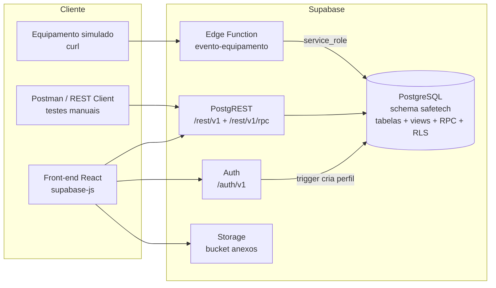

# Checkpoint 2 — Plano de ação (entrega 13/11/2026)

**O que o edital pede:** "Endpoints principais criados e conexão com o banco de dados funcionando."

**Como vamos entregar:** o back-end será o **Supabase** (PostgreSQL gerenciado + API REST automática + Auth +
Edge Functions). O banco modelado no Checkpoint 1 sobe para o Supabase, e os endpoints são de três tipos:

| Tipo | O que é | Exemplo |
|------|---------|---------|
| **REST automático (PostgREST)** | Toda tabela/view do schema `safetech` vira endpoint `GET/POST/PATCH/DELETE /rest/v1/<tabela>` com filtros na URL. O que cada usuário pode ver/alterar é controlado por **RLS** (Row Level Security). | `GET /rest/v1/praca?cidade=eq.Recife` |
| **RPC (funções SQL)** | Regras de negócio escritas em PL/pgSQL e chamadas por `POST /rest/v1/rpc/<funcao>`. | `POST /rest/v1/rpc/registrar_ocorrencia` |
| **Edge Function (Deno/TypeScript)** | Código customizado rodando na borda, para integrações externas (eventos de câmeras/sensores). | `POST /functions/v1/evento-equipamento` |
| **Auth (nativo)** | Cadastro, login e sessão (JWT) prontos. | `POST /auth/v1/token?grant_type=password` |

## Arquitetura

## Endpoints principais e responsáveis

| # | Endpoint | Método | Quem pode | Responsável |
|---|----------|--------|-----------|-------------|
| 1 | `/auth/v1/signup` | POST | público | Lucas (config) / Santhiago (uso) |
| 2 | `/auth/v1/token?grant_type=password` | POST | público | Lucas / Santhiago |
| 3 | `/rest/v1/praca` | GET | público | Lucas (RLS) |
| 4 | `/rest/v1/vw_praca_resumo` | GET | público | Lucas |
| 5 | `/rest/v1/categoria_ocorrencia` | GET | público | Lucas |
| 6 | `/rest/v1/equipamento` | GET / POST / PATCH | logado / gestor | Lucas |
| 7 | `/rest/v1/ocorrencia` | GET / PATCH | logado / equipe | Lucas |
| 8 | `/rest/v1/vw_ocorrencia_aberta` | GET | logado | Lucas |
| 9 | `/rest/v1/historico_ocorrencia` | GET | logado | Lucas |
| 10 | `/rest/v1/anexo_ocorrencia` + Storage `anexos` | GET / POST | logado | Lucas |
| 11 | `/rest/v1/alerta`, `/rest/v1/vw_alerta_pendente` | GET / PATCH | equipe | Lucas |
| 12 | `/rest/v1/atendimento`, `/rest/v1/ronda` | GET / POST / PATCH | equipe | Lucas |
| 13 | `/rest/v1/avaliacao_praca` | GET / POST | público / logado | Lucas |
| 14 | `/rest/v1/notificacao` | GET / PATCH | dono | Lucas |
| 15 | `rpc/registrar_ocorrencia` | POST | público (anônima) / logado | Davi |
| 16 | `rpc/consultar_protocolo` | POST | público | Davi |
| 17 | `rpc/atualizar_status_ocorrencia` | POST | equipe | Davi |
| 18 | `rpc/atribuir_atendimento` | POST | equipe | Davi |
| 19 | `rpc/finalizar_atendimento` | POST | equipe | Davi |
| 20 | `rpc/reconhecer_alerta` | POST | equipe | Davi |
| 21 | `rpc/acionar_botao_panico` | POST | público | Davi |
| 22 | `/functions/v1/evento-equipamento` | POST | dispositivo (segredo) | Davi |

"Equipe" = perfil AGENTE, GESTOR ou ADMIN. "Logado" = qualquer usuário autenticado.

## Quem faz o quê

| Membro | Papel | Roteiro | Resumo |
|--------|-------|---------|--------|
| Lucas Victor | Engenheiro de Dados | [roteiro-lucas.md](roteiro-lucas.md) | Projeto Supabase, migrations (DDL + seeds), expor schema, Auth ↔ `usuario`, RLS, Storage, usuários de teste. **É a base: entrega hoje (11/11) para destravar os demais.** |
| Davi Mendes | Back-end | [roteiro-davi.md](roteiro-davi.md) | 7 funções RPC em SQL, Edge Function `evento-equipamento`, testes via REST. |
| Santhiago Augusto | Front-end | [roteiro-santhiago.md](roteiro-santhiago.md) | App React + supabase-js: cadastro/login, lista de praças, nova ocorrência, consulta de protocolo. |
| Ana Carolina | Product Manager | [roteiro-ana.md](roteiro-ana.md) | Contrato da API (`docs/api/endpoints.md`), coleção de testes `.http`, issues/quadro no GitHub, documento de arquitetura, roteiro da demo. |
| Membro 5 (se houver) | QA | [roteiro-qa.md](roteiro-qa.md) | Casos de teste dos endpoints e evidências. Sem 5º membro, a Ana absorve. |

## Cronograma (3 dias)

| Dia | Lucas | Davi | Santhiago | Ana |
|-----|-------|------|-----------|-----|
| **Ter 11/11** | Cria projeto, aplica DDL + seeds, expõe schema, Auth, RLS, bucket. Publica URL + anon key no grupo até 20h. | Cria `08_rpc.sql` e testa no SQL Editor assim que o projeto existir. Instala Supabase CLI. | Scaffold Vite + React, cliente supabase-js, telas de cadastro e login. | Cria issues e quadro no GitHub, `docs/api/endpoints.md` v1, `docs/api/safetech.http`. |
| **Qua 12/11** | Suporte aos demais, cria usuários de teste por perfil, revisa PRs, diagrama de arquitetura. | Deploy da Edge Function, testa todos os RPCs com `.http`, abre PR. | Lista de praças, nova ocorrência (RPC), consulta de protocolo, abre PR. | Testa cada endpoint com `.http`, salva evidências, escreve `docs/arquitetura/arquitetura.md`. |
| **Qui 13/11** | Merge final, tag `checkpoint-2`. | Ensaio da demo (back). | Ensaio da demo (front). | Conduz a apresentação, checklist de entrega. |

## Definição de pronto (Checkpoint 2)

- [ ] Projeto Supabase online com o schema `safetech`, seeds carregados e schema exposto na API.
- [ ] Cadastro e login funcionando (usuário criado no Auth aparece em `safetech.usuario`).
- [ ] Os 22 endpoints acima respondem; cada um tem exemplo de requisição em `docs/api/safetech.http`.
- [ ] RLS ativo: anon não lê ocorrências; cidadão não vê alertas; só equipe altera status.
- [ ] Front-end lista praças do banco e registra uma ocorrência (prova de ponta a ponta).
- [ ] Edge Function recebe um evento de equipamento e gera um alerta no banco.
- [ ] `docs/api/endpoints.md` e `docs/arquitetura/arquitetura.md` atualizados.
- [ ] README com instruções de configuração (`.env.example`).
- [ ] Tudo em `main` via Pull Request com revisão, e tag `checkpoint-2`.

## Regras de trabalho

- **Branches:** `feat/cp2-lucas`, `feat/cp2-davi`, `feat/cp2-santhiago`, `docs/cp2-ana`. PR para `main`, revisão cruzada (Lucas ↔ Davi, Santhiago ↔ Ana).
- **Nunca commitar chaves.** A `anon key` e a URL vão em `.env` (ignorado pelo git); o repositório só tem `.env.example`. A `service_role key` só fica no painel do Supabase e nos secrets da Edge Function.
- **Compartilhamento de credenciais:** Lucas publica URL e anon key no grupo privado da equipe (não em issues públicas).
- **SQL versionado:** tudo que for executado no SQL Editor do Supabase é salvo em `database/supabase/NN_nome.sql` no mesmo PR. O painel não é a fonte da verdade; o repositório é.
- **Schema `safetech`:** como o schema não é o `public`, toda chamada REST precisa do cabeçalho `Accept-Profile: safetech` (GET) ou `Content-Profile: safetech` (POST/PATCH/RPC). No supabase-js isso é automático com `createClient(url, key, { db: { schema: 'safetech' } })`.
- **Dúvidas:** no grupo da equipe, marcando o responsável da área. Bloqueio por mais de 1h → avisar o Lucas.
