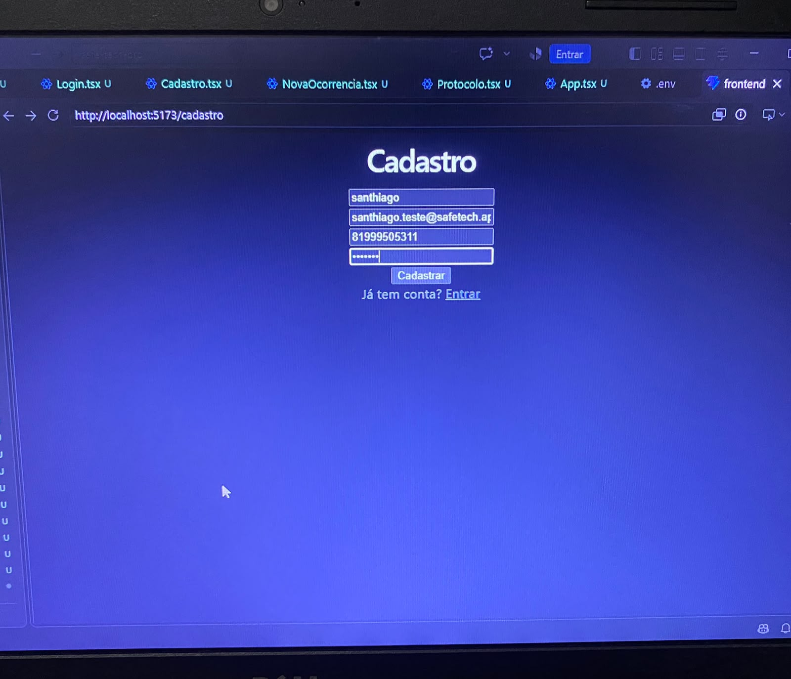
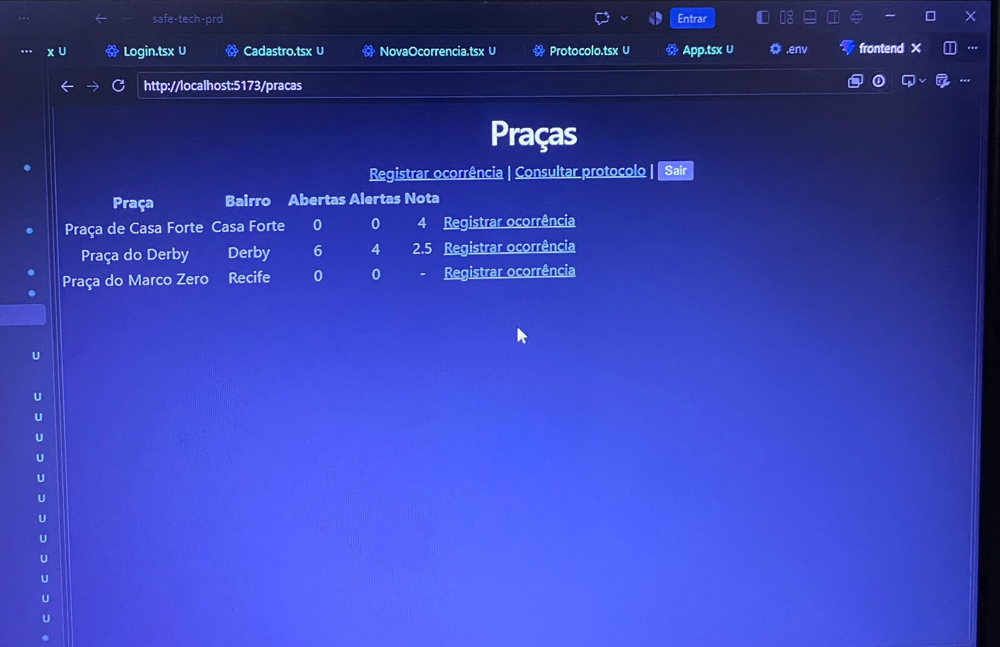
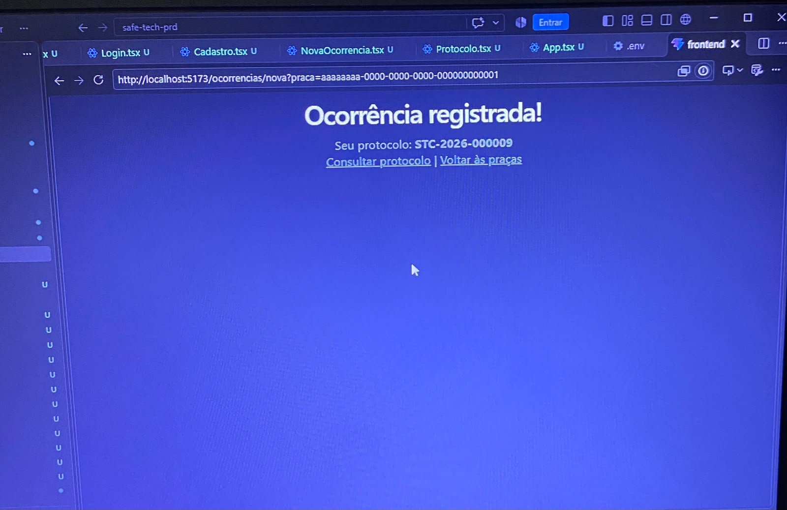
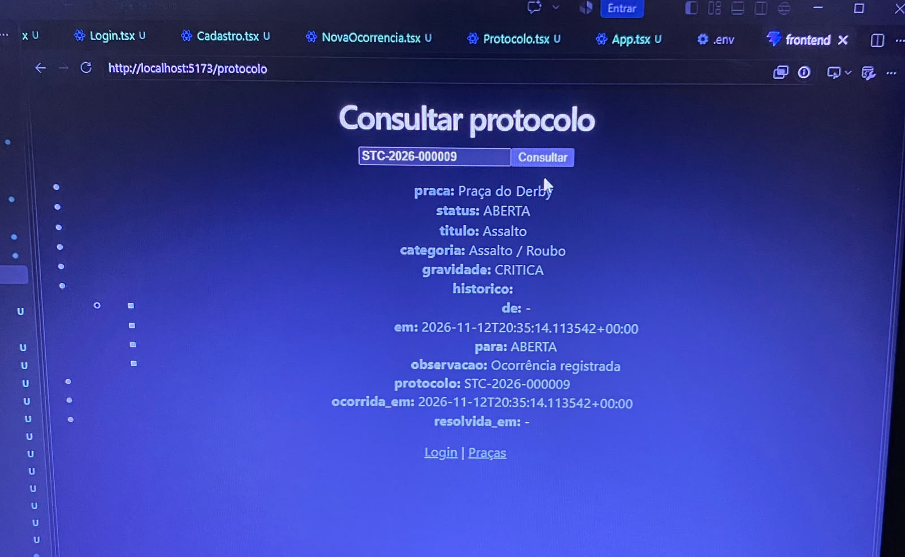

# Evidências: Front-end (Santhiago)

Fluxo testado: cadastro → praças → ocorrência → protocolo.

## 1. Cadastro
](1-cadastro.png)

## 2. Lista de praças vinda do banco
](2-pracas.png)

## 3. Ocorrência registrada
](3-ocorrencia-registrada.png)

## 4. Consulta de protocolo sem login
](4-protocolo-consulta.png)

## 5. Perfil criado no Supabase
