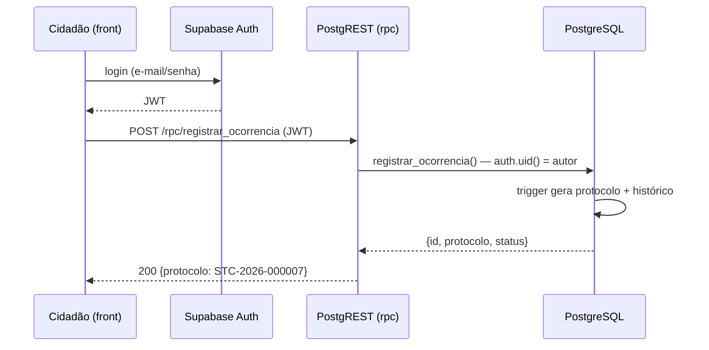

# Roteiro — Ana Carolina (Product Manager)

**Objetivo:** organizar a entrega, documentar o contrato da API, testar todos os endpoints e preparar a apresentação.
Você não precisa programar, mas vai executar chamadas HTTP reais contra o banco. É a sua parte "mão na massa".
**Prazo:** issues e quadro hoje (11/11); contrato + testes + arquitetura na quarta (12/11).
**Branch:** `docs/cp2-ana`

## Passo 1 — Quadro e issues no GitHub (hoje)

1. No repositório: **Projects → New project → Board**, nome `Checkpoint 2`. Colunas: `A fazer`, `Em andamento`, `Em revisão`, `Concluído`.
2. Crie uma issue por item abaixo, com responsável e label (`backend`, `frontend`, `banco`, `docs`), e coloque no quadro:

| Issue | Responsável |
|-------|-------------|
| CP2-01 Criar projeto Supabase e aplicar DDL + seeds | Lucas |
| CP2-02 Expor schema `safetech` e grants da API | Lucas |
| CP2-03 Integrar Supabase Auth com tabela `usuario` | Lucas |
| CP2-04 Ativar RLS em todas as tabelas | Lucas |
| CP2-05 Bucket `anexos` e usuários de teste | Lucas |
| CP2-06 Funções RPC (7 endpoints de negócio) | Davi |
| CP2-07 Edge Function `evento-equipamento` | Davi |
| CP2-08 Front: scaffold + cliente supabase + auth | Santhiago |
| CP2-09 Front: praças, nova ocorrência, protocolo | Santhiago |
| CP2-10 Contrato da API (`docs/api/endpoints.md`) | Ana |
| CP2-11 Coleção de testes (`docs/api/safetech.http`) e evidências | Ana |
| CP2-12 Documento de arquitetura | Ana |
| CP2-13 Roteiro e ensaio da demo | Ana |
| CP2-14 README: configuração e tag `checkpoint-2` | Lucas |

3. Fixe no grupo da equipe o link do quadro e a regra: *moveu de coluna = atualizou a issue*.

## Passo 2 — Instalar a ferramenta de testes

No VS Code instale a extensão **REST Client** (humao.rest-client). Ela executa arquivos `.http` com um clique em
"Send Request", sem precisar de Postman.

## Passo 3 — Coleção de testes `docs/api/safetech.http`

Crie o arquivo abaixo. Preencha `@baseUrl` e `@anonKey` com o que o Lucas enviar no grupo. **Não commite as chaves:**
antes de commitar, substitua pelos textos `SUA_URL` e `SUA_ANON_KEY`.

```http
### Variáveis (não commitar valores reais)
@baseUrl = https://SEU-REF.supabase.co
@anonKey = SUA_ANON_KEY
@schemaGet = Accept-Profile: safetech
@schemaPost = Content-Profile: safetech

### ---------- AUTH ----------

### 1. Cadastro
POST {{baseUrl}}/auth/v1/signup
apikey: {{anonKey}}
Content-Type: application/json

{ "email": "ana.teste@safetech.app", "password": "Senha@123", "data": { "nome": "Ana Teste", "telefone": "81999990000" } }

### 2. Login (copie o access_token da resposta para @token)
# @name login
POST {{baseUrl}}/auth/v1/token?grant_type=password
apikey: {{anonKey}}
Content-Type: application/json

{ "email": "gestor.demo@safetech.app", "password": "Senha@123" }

@token = {{login.response.body.access_token}}

### 3. Usuário atual
GET {{baseUrl}}/auth/v1/user
apikey: {{anonKey}}
Authorization: Bearer {{token}}

### ---------- REST PÚBLICO ----------

### 4. Praças
GET {{baseUrl}}/rest/v1/praca?select=id,nome,bairro,cidade&order=nome
apikey: {{anonKey}}
{{schemaGet}}

### 5. Resumo por praça (dashboard)
GET {{baseUrl}}/rest/v1/vw_praca_resumo?select=nome,ocorrencias_abertas,alertas_novos,nota_media_seguranca
apikey: {{anonKey}}
{{schemaGet}}

### 6. Categorias
GET {{baseUrl}}/rest/v1/categoria_ocorrencia?select=id,nome,gravidade_padrao&ativa=eq.true
apikey: {{anonKey}}
{{schemaGet}}

### 7. Ocorrências SEM login (esperado: erro 401/permission denied)
GET {{baseUrl}}/rest/v1/ocorrencia
apikey: {{anonKey}}
{{schemaGet}}

### ---------- REST LOGADO ----------

### 8. Meu perfil
GET {{baseUrl}}/rest/v1/usuario?select=nome,email,perfil
apikey: {{anonKey}}
Authorization: Bearer {{token}}
{{schemaGet}}

### 9. Ocorrências abertas (view)
GET {{baseUrl}}/rest/v1/vw_ocorrencia_aberta?order=criado_em.desc
apikey: {{anonKey}}
Authorization: Bearer {{token}}
{{schemaGet}}

### 10. Histórico de uma ocorrência (troque o id)
GET {{baseUrl}}/rest/v1/historico_ocorrencia?ocorrencia_id=eq.cccccccc-0000-0000-0000-000000000001&order=alterado_em
apikey: {{anonKey}}
Authorization: Bearer {{token}}
{{schemaGet}}

### 11. Equipamentos de uma praça
GET {{baseUrl}}/rest/v1/equipamento?praca_id=eq.aaaaaaaa-0000-0000-0000-000000000001&select=codigo,tipo,status
apikey: {{anonKey}}
Authorization: Bearer {{token}}
{{schemaGet}}

### 12. Alertas pendentes (só equipe)
GET {{baseUrl}}/rest/v1/vw_alerta_pendente
apikey: {{anonKey}}
Authorization: Bearer {{token}}
{{schemaGet}}

### 13. Atendimentos em aberto (só equipe)
GET {{baseUrl}}/rest/v1/atendimento?finalizado_em=is.null
apikey: {{anonKey}}
Authorization: Bearer {{token}}
{{schemaGet}}

### 14. Rondas agendadas (só equipe)
GET {{baseUrl}}/rest/v1/ronda?status=eq.AGENDADA
apikey: {{anonKey}}
Authorization: Bearer {{token}}
{{schemaGet}}

### 15. Avaliar praça (usuario_id = id do usuário logado, veja req. 3)
POST {{baseUrl}}/rest/v1/avaliacao_praca
apikey: {{anonKey}}
Authorization: Bearer {{token}}
Content-Type: application/json
Prefer: return=representation
{{schemaPost}}

{ "praca_id": "aaaaaaaa-0000-0000-0000-000000000003", "usuario_id": "<id do usuário logado>", "nota": 4, "comentario": "Boa iluminação" }

### 16. Minhas notificações não lidas
GET {{baseUrl}}/rest/v1/notificacao?lida=eq.false&order=criado_em.desc
apikey: {{anonKey}}
Authorization: Bearer {{token}}
{{schemaGet}}

### 17. Marcar notificação como lida (troque o id)
PATCH {{baseUrl}}/rest/v1/notificacao?id=eq.<id>
apikey: {{anonKey}}
Authorization: Bearer {{token}}
Content-Type: application/json
{{schemaPost}}

{ "lida": true, "lida_em": "2026-11-12T12:00:00Z" }

### ---------- RPC ----------

### 18. Consultar protocolo (público)
POST {{baseUrl}}/rest/v1/rpc/consultar_protocolo
apikey: {{anonKey}}
Content-Type: application/json
{{schemaPost}}

{ "p_protocolo": "STC-2026-000001" }

### 19. Registrar ocorrência anônima (público)
POST {{baseUrl}}/rest/v1/rpc/registrar_ocorrencia
apikey: {{anonKey}}
Content-Type: application/json
{{schemaPost}}

{ "p_praca_id": "aaaaaaaa-0000-0000-0000-000000000001", "p_categoria_id": 3, "p_titulo": "Assalto na saída", "p_descricao": "Relato anônimo", "p_anonima": true }

### 20. Registrar ocorrência identificada (logado)
POST {{baseUrl}}/rest/v1/rpc/registrar_ocorrencia
apikey: {{anonKey}}
Authorization: Bearer {{token}}
Content-Type: application/json
{{schemaPost}}

{ "p_praca_id": "aaaaaaaa-0000-0000-0000-000000000002", "p_categoria_id": 1, "p_titulo": "Poste apagado", "p_descricao": "Poste em frente à quadra", "p_gravidade": "MEDIA" }

### 21. Atualizar status (equipe) — troque o id pelo retornado em 20
POST {{baseUrl}}/rest/v1/rpc/atualizar_status_ocorrencia
apikey: {{anonKey}}
Authorization: Bearer {{token}}
Content-Type: application/json
{{schemaPost}}

{ "p_ocorrencia_id": "<id>", "p_status": "EM_ANALISE", "p_observacao": "Triagem feita" }

### 22. Atribuir atendimento (equipe)
POST {{baseUrl}}/rest/v1/rpc/atribuir_atendimento
apikey: {{anonKey}}
Authorization: Bearer {{token}}
Content-Type: application/json
{{schemaPost}}

{ "p_ocorrencia_id": "<id>" }

### 23. Finalizar atendimento (equipe) — id retornado em 22
POST {{baseUrl}}/rest/v1/rpc/finalizar_atendimento
apikey: {{anonKey}}
Authorization: Bearer {{token}}
Content-Type: application/json
{{schemaPost}}

{ "p_atendimento_id": "<id>", "p_relato": "Poste trocado", "p_resolver": true }

### 24. Acionar botão de pânico (público)
POST {{baseUrl}}/rest/v1/rpc/acionar_botao_panico
apikey: {{anonKey}}
Content-Type: application/json
{{schemaPost}}

{ "p_equipamento_codigo": "BTN-DERBY-01" }

### 25. Reconhecer alerta (equipe) — id vindo da req. 12
POST {{baseUrl}}/rest/v1/rpc/reconhecer_alerta
apikey: {{anonKey}}
Authorization: Bearer {{token}}
Content-Type: application/json
{{schemaPost}}

{ "p_alerta_id": "<id>", "p_status": "RECONHECIDO" }

### ---------- EDGE FUNCTION ----------

### 26. Evento de equipamento (segredo combinado com o Davi)
POST {{baseUrl}}/functions/v1/evento-equipamento
x-device-secret: SEGREDO
Content-Type: application/json

{ "codigo": "CAM-DERBY-01", "evento": "SEM_SINAL" }
```

Execute na ordem 1 → 26 com o usuário `gestor.demo@safetech.app`. Depois repita 7, 9, 12 e 21 logada como
`cidadao.demo@safetech.app` e confirme que o RLS bloqueia (isso vale ponto em "Estrutura e Persistência de Dados").

## Passo 4 — Contrato da API `docs/api/endpoints.md`

Para cada um dos 26 itens acima, uma seção com: **nome**, **método + caminho**, **quem pode chamar**,
**cabeçalhos**, **corpo de exemplo**, **resposta de exemplo** (cole o JSON real que você recebeu) e **erros possíveis**.
Comece pelo cabeçalho:

```markdown
# API SafeTech — Contrato (Checkpoint 2)

Base URL: `https://<ref>.supabase.co` · Schema: `safetech`
Cabeçalhos obrigatórios: `apikey` (anon key); `Authorization: Bearer <jwt>` quando logado;
`Accept-Profile: safetech` em GET e `Content-Profile: safetech` em POST/PATCH/RPC.

| # | Endpoint | Método | Acesso | Descrição |
|---|----------|--------|--------|-----------|
| ... (copie a tabela de docs/checkpoint-2/README.md) |
```

Evidências (prints do REST Client com a resposta) vão em `docs/checkpoint-2/evidencias/ana-endpoints.md`.

## Passo 5 — Documento de arquitetura `docs/arquitetura/arquitetura.md`

Seções (use o Template de Documentação da disciplina como base e preencha com o nosso conteúdo):

1. **Visão geral da solução** (problema, usuários: cidadão, agente, gestor, admin).
2. **Arquitetura** — copie o diagrama Mermaid de `docs/checkpoint-2/README.md` e explique cada caixa.
3. **Tecnologias e justificativa** — Supabase (PostgreSQL, PostgREST, Auth, Edge Functions, Storage), React + Vite,
   supabase-js, GitHub. Por que: custo zero, API pronta sobre o modelo do CP1, segurança por RLS, menos código para o prazo.
4. **Modelo de dados** — link para `docs/modelagem/modelo-logico.md` e resumo das 12 tabelas.
5. **Segurança** — Auth JWT, RLS por perfil, `service_role` só no servidor, segredo da Edge Function, LGPD (anonimato).
6. **Endpoints** — link para `docs/api/endpoints.md`.
7. **Fluxos principais** — diagrama de sequência Mermaid de "cidadão registra ocorrência" e "botão de pânico":



8. **Próximos passos (Checkpoint 3)** — telas completas, upload de anexos, painel do gestor, notificações em tempo real (Supabase Realtime).

## Passo 6 — Roteiro da demo (13/11, 8 minutos)

1. **Ana (1 min):** contexto, arquitetura (diagrama), quadro do GitHub com tudo concluído.
2. **Lucas (2 min):** painel do Supabase: tabelas, seeds, RLS ativo; `healthcheck.sh` rodando.
3. **Davi (2 min):** REST Client: consultar protocolo, botão de pânico, mudança de status como gestor e bloqueio como cidadão; Edge Function gerando alerta.
4. **Santhiago (2 min):** front: cadastro → lista de praças → nova ocorrência → protocolo.
5. **Ana (1 min):** entregáveis (repo, docs, tag) e próximos passos.

Ensaio na quarta às 20h (chamada de vídeo). Prepare um checklist de entrega e marque no quadro.

## Passo 7 — Pull Request

Inclua `docs/api/endpoints.md`, `docs/api/safetech.http` (sem chaves), `docs/arquitetura/arquitetura.md`,
`docs/checkpoint-2/evidencias/ana-endpoints.md`. Peça revisão ao Santhiago.
