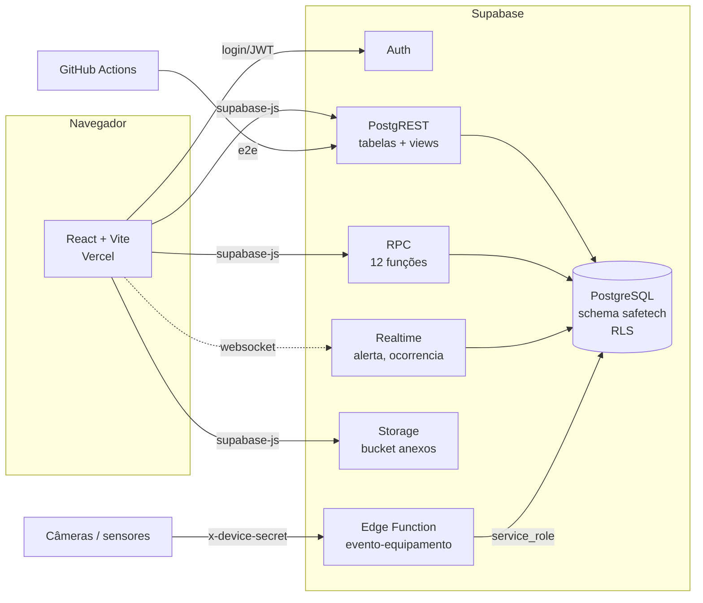

# Checkpoint 3 — MVP funcional (entrega 27/11/2026)

> **O que o edital pede:** "Aplicação funcional ('MVP' integrado). Front-end consumindo o Back-end."
> **O que isso significa para nós:** as telas do protótipo da AV1 funcionando de ponta a ponta, por perfil
> (cidadão, agente, gestor), lendo e gravando no Supabase, publicadas em uma URL e cobertas por testes.

**Situação ao começar (25/11):** back-end completo e testado no CP2 (65/65 no e2e), front com 5 telas básicas
(cadastro, login, praças, nova ocorrência, protocolo) sem layout, sem perfis e sem as telas da equipe.

**Prazo:** 3 dias (qua 25, qui 26, sex 27). Por isso o plano é enxuto: cada pessoa entrega algo visível
e todo código que entra já vem **escrito e verificado** nos roteiros (SQL testado no PGlite, front com
`tsc`, `eslint` e `vite build` passando). O trabalho de cada um é aplicar, integrar, testar no projeto real
e abrir o PR.

## Escopo do MVP

| Tela do protótipo | Rota | Perfil | Dono | Status |
|-------------------|------|--------|------|--------|
| Login / Cadastro | `/login`, `/cadastro` | todos | Santhiago | existe → ganha layout e redirecionamento por perfil |
| Lista de praças | `/pracas` | público | Santhiago | existe → vira pública, com busca e cartões |
| **Detalhe da praça** | `/pracas/:id` | público | Santhiago | **novo**: equipamentos, ocorrências abertas, avaliações, mapa |
| Registrar ocorrência | `/ocorrencias/nova` | logado | Santhiago | existe → ganha **anexo de foto/vídeo** |
| Minhas ocorrências / Protocolo | `/minhas-ocorrencias`, `/protocolo` | cidadão / público | Santhiago | **novo** / existe → linha do tempo |
| **Painel de ocorrências** | `/painel` | equipe | Davi | **novo**: fila, assumir, status, finalizar |
| **Alertas em tempo real** | `/alertas` | equipe | Davi | **novo**: Realtime + reconhecer/encerrar |
| **Dashboard do gestor** | `/dashboard` | gestor/admin | Lucas | **novo**: indicadores, séries, ranking |
| Rondas | — | — | — | **fora do MVP** (fica para a AV2 se sobrar tempo) |
| Administração (praças, equipamentos, usuários) | — | — | — | **fora do MVP** (gestor cria praça via SQL/REST) |

Além das telas: **deploy público** (Vercel), **CI** no GitHub (lint, build e e2e em todo PR), **massa de dados
de demonstração**, documentação de arquitetura e manual de uso atualizados, e testes manuais por perfil.

## Arquitetura (o que muda em relação ao CP2)

Novidades: **4 RPCs** (`detalhe_praca`, `avaliar_praca`, `registrar_anexo`, `dashboard_resumo`), **Realtime**
na tabela `alerta`, views `vw_ocorrencia_aberta` e `vw_alerta_pendente` passam a respeitar o RLS de quem
consulta (`security_invoker`), índice único de avaliação por usuário/praça, política para apagar o próprio anexo.

## Quem faz o quê

| Membro | Papel | Roteiro | Entrega |
|--------|-------|---------|---------|
| Santhiago Augusto | Front-end | [roteiro-santhiago.md](roteiro-santhiago.md) | Base do app (contexto de autenticação, layout, rotas por perfil, CSS) + telas do cidadão: detalhe da praça, avaliação, anexo, minhas ocorrências, protocolo com linha do tempo. **A base dele destrava Davi e Lucas: merge até 14h de quarta.** |
| Davi Mendes | Back-end | [roteiro-davi.md](roteiro-davi.md) | SQL das 4 RPCs novas (`database/supabase/09_rpc_cp3.sql`) + telas da equipe: painel de ocorrências e alertas em tempo real. |
| Lucas Victor | Engenheiro de Dados | [roteiro-lucas.md](roteiro-lucas.md) | Hardening (`10_hardening_cp3.sql`: security_invoker, Realtime, índice), seed de demonstração, dashboard do gestor, deploy na Vercel, CI no GitHub, e2e ampliado, tag. |
| Ana Carolina | Product Manager | [roteiro-ana.md](roteiro-ana.md) | Matriz de aderência protótipo × MVP (com capturas), `docs/api/endpoints.md` v2, `docs/arquitetura/arquitetura.md` v2, manual do usuário, issues CP3, roteiro da apresentação do CP3 e esboço do pitch da AV2. |
| Membro 5 / QA | QA | [roteiro-qa.md](roteiro-qa.md) | Plano de testes manuais por perfil (CT11–CT30), execução na quinta e na sexta, bugs como issues, evidências. Sem 5º membro, Ana absorve. |

## Cronograma

| Dia | Santhiago | Davi | Lucas | Ana / QA |
|-----|-----------|------|-------|----------|
| **Qua 25/11** | Manhã: `AuthContext`, `Layout`, `RotaProtegida`, `App.tsx`, CSS, páginas-stub. **PR da base até 14h.** Tarde: detalhe da praça + avaliação. | Manhã: aplica `09_rpc_cp3.sql` no SQL Editor, testa com `curl`, PR do SQL. Tarde: `api/equipe.ts`, `api/alertas.ts`, página Painel. | Manhã: `10_hardening_cp3.sql` + seed de demo no SQL Editor, roda e2e. Tarde: projeto na Vercel apontando para `main`, CI no GitHub, secrets. | Issues CP3-01..16 e quadro. Mapa de telas × rotas. Começa `endpoints.md` v2. QA: escreve CT11–CT30. |
| **Qui 26/11** | Anexo na nova ocorrência, Minhas ocorrências, Protocolo com linha do tempo, Login por perfil. PR. | Alertas com Realtime, filtros do painel, PR. Ajuda Santhiago no que travar. | Dashboard do gestor, e2e com os casos do CP3, revisa PRs, redeploy. | Arquitetura v2, manual do usuário. QA: executa CT11–CT30 na URL da Vercel, abre bugs. |
| **Sex 27/11** | Manhã: correções dos bugs do QA. Ensaio. | Manhã: correções. Ensaio. | Merge final, `git tag checkpoint-3`, deploy final, e2e verde na CI. | Conduz a apresentação. QA: reexecuta os CTs que falharam, fecha issues. |

## Definição de pronto (Checkpoint 3)

- [ ] URL pública na Vercel abre a lista de praças sem login e carrega dados do Supabase.
- [ ] Cadastro → login → cada perfil cai na sua tela (cidadão: praças; agente: painel; gestor: dashboard).
- [ ] Cidadão: vê detalhe da praça, avalia (nota 1–5), registra ocorrência **com foto**, vê suas ocorrências e a linha do tempo pelo protocolo.
- [ ] Agente: vê fila no painel, assume uma ocorrência (vira EM ATENDIMENTO), finaliza (vira RESOLVIDA), reconhece um alerta.
- [ ] Alerta criado pela Edge Function ou pelo botão de pânico **aparece na tela de alertas sem recarregar**.
- [ ] Gestor: dashboard com indicadores, gráfico por dia e ranking de praças.
- [ ] Cidadão **não** acessa `/painel`, `/alertas`, `/dashboard` (mensagem de perfil sem acesso) e não lê alertas pela API.
- [ ] `node database/scripts/e2e.mjs` verde (≈85 testes) e CI verde no último PR.
- [ ] `docs/api/endpoints.md`, `docs/arquitetura/arquitetura.md`, `docs/prototipo/README.md` (aderência) e README atualizados; manual do usuário publicado.
- [ ] Tudo em `main` via PR revisado, tag `checkpoint-3`.

## Regras de trabalho

- **Branches:** `feat/cp3-santhiago`, `feat/cp3-davi`, `feat/cp3-lucas`, `docs/cp3-ana`, `test/cp3-qa`. PR pequeno, um por dia por pessoa. Revisão cruzada: Santhiago ↔ Davi, Lucas ↔ Ana.
- **Ordem de merge no dia 25:** 1º base do Santhiago, 2º SQL do Davi e do Lucas. Painel, Alertas e Dashboard só começam depois de `git pull` da base, porque usam `useAuth()` e as classes do CSS.
- **Donos de arquivo (evita conflito):** `App.tsx`, `index.css`, `contexts/`, `components/` → Santhiago. `pages/Painel.tsx`, `pages/Alertas.tsx`, `api/equipe.ts`, `api/alertas.ts` → Davi. `pages/Dashboard.tsx`, `api/dashboard.ts`, `vercel.json`, `.github/workflows/` → Lucas. Precisa mexer em arquivo de outro? Avisa no grupo antes.
- **SQL versionado:** tudo que rodar no SQL Editor vai para `database/supabase/NN_nome.sql` no mesmo PR.
- **Chaves:** continuam só no `.env` local, nos secrets da Vercel e nos secrets do GitHub. Nunca no código.
- **Dados de teste:** o e2e cria registros com prefixo `[E2E]`. Antes da apresentação, Lucas limpa com o SQL do roteiro dele.
- **Bloqueio por mais de 1h:** avisa no grupo marcando o dono da área.
