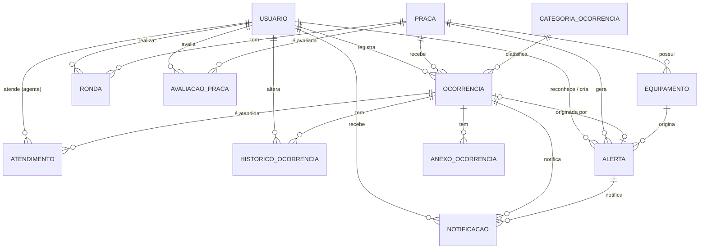

# Modelo Conceitual — SafeTech

## 1. Contexto

O SafeTech é uma plataforma de apoio à segurança em praças públicas. Ela conecta três grupos:

- **Cidadãos**, que frequentam as praças, registram ocorrências (com ou sem identificação), anexam fotos e
  avaliam a sensação de segurança de cada praça.
- **Agentes de campo** (guarda municipal / equipes de segurança), que recebem ocorrências, realizam rondas
  e registram o atendimento.
- **Gestores públicos e administradores**, que acompanham indicadores por praça, distribuem atendimentos,
  reconhecem alertas e cadastram praças, equipamentos e usuários.

Além das pessoas, a plataforma recebe eventos de **equipamentos de segurança** instalados nas praças
(câmeras, iluminação inteligente, botões de pânico, totens e sensores), que geram **alertas** em tempo real.

## 2. Entidades

| Entidade | Descrição | Identificador |
|----------|-----------|---------------|
| **Usuário** | Pessoa que acessa a plataforma. Possui um perfil (Cidadão, Agente, Gestor, Admin). | id (UUID), e-mail único |
| **Praça** | Espaço público monitorado. Possui endereço, geolocalização e horário de funcionamento. | id (UUID) |
| **Equipamento** | Dispositivo de segurança instalado em uma praça (câmera, iluminação, botão de pânico, totem, sensor). | id (UUID), código único |
| **Categoria de Ocorrência** | Classificação das ocorrências (iluminação, vandalismo, assalto...). Define gravidade padrão. | id, nome único |
| **Ocorrência** | Relato de um problema de segurança em uma praça. Tem protocolo, gravidade, status e pode ser anônima. | id (UUID), protocolo único |
| **Anexo** | Foto, vídeo ou documento ligado a uma ocorrência. | id (UUID) |
| **Histórico de Ocorrência** | Cada mudança de status de uma ocorrência, com responsável e data. | id |
| **Atendimento** | Vínculo entre um agente e uma ocorrência que ele atende; guarda o relato final. | id (UUID) |
| **Alerta** | Evento em tempo real originado por equipamento, botão de pânico ou registro manual. Pode gerar uma ocorrência. | id (UUID) |
| **Ronda** | Patrulha agendada ou realizada por um agente em uma praça. | id (UUID) |
| **Avaliação de Praça** | Nota de 1 a 5 dada por um cidadão sobre a sensação de segurança da praça. | id (UUID) |
| **Notificação** | Mensagem in-app enviada a um usuário, geralmente ligada a uma ocorrência ou alerta. | id (UUID) |

## 3. Relacionamentos

| Relacionamento | Cardinalidade | Descrição |
|----------------|---------------|-----------|
| Praça **possui** Equipamento | 1 : N | Uma praça tem vários equipamentos; cada equipamento pertence a uma única praça. |
| Praça **recebe** Ocorrência | 1 : N | Toda ocorrência é registrada em exatamente uma praça. |
| Categoria **classifica** Ocorrência | 1 : N | Cada ocorrência tem uma única categoria. |
| Usuário **registra** Ocorrência | 0..1 : N | Ocorrências anônimas não possuem autor. |
| Ocorrência **tem** Anexo | 1 : N | Uma ocorrência pode ter vários anexos. |
| Ocorrência **tem** Histórico | 1 : N | Cada transição de status gera um registro de histórico. |
| Ocorrência **é atendida por** Usuário (Agente) via Atendimento | N : N | Resolvido pela entidade associativa *Atendimento*, que guarda início, fim e relato. |
| Usuário (Gestor) **atribui** Atendimento | 0..1 : N | Quem fez a atribuição. |
| Praça **gera** Alerta | 1 : N | Todo alerta pertence a uma praça. |
| Equipamento **origina** Alerta | 0..1 : N | Alertas de origem EQUIPAMENTO ou BOTAO_PANICO apontam para o equipamento. |
| Alerta **gera** Ocorrência | 0..1 : 0..1 | Um alerta pode ser convertido em uma ocorrência. |
| Usuário **reconhece** Alerta | 0..1 : N | Agente/gestor que reconheceu o alerta. |
| Praça **tem** Ronda / Usuário (Agente) **realiza** Ronda | 1 : N / 1 : N | Cada ronda ocorre em uma praça e é feita por um agente. |
| Praça **é avaliada por** Usuário via Avaliação | N : N | Entidade associativa *Avaliação de Praça* (nota + comentário). |
| Usuário **recebe** Notificação | 1 : N | Notificação pode referenciar uma ocorrência ou um alerta. |

## 4. Regras de negócio

1. **RN01 – Perfis.** Todo usuário possui exatamente um perfil: CIDADAO, AGENTE, GESTOR ou ADMIN.
2. **RN02 – Anonimato.** Uma ocorrência pode ser anônima; nesse caso o autor não é exibido e pode não ser armazenado.
   Ocorrências não anônimas obrigatoriamente possuem autor.
3. **RN03 – Protocolo.** Toda ocorrência recebe um protocolo único no formato `STC-AAAA-NNNNNN`, gerado automaticamente.
4. **RN04 – Ciclo de status.** Ocorrência segue `ABERTA → EM_ANALISE → EM_ATENDIMENTO → RESOLVIDA`, podendo ser `CANCELADA`
   a qualquer momento antes de resolvida. Toda mudança de status é registrada no histórico.
5. **RN05 – Atendimento.** Somente usuários com perfil AGENTE, GESTOR ou ADMIN podem ser responsáveis por atendimentos e rondas.
   Ao atribuir um atendimento, a ocorrência passa automaticamente para `EM_ATENDIMENTO`.
6. **RN06 – Gravidade.** Ocorrências e alertas possuem gravidade (BAIXA, MEDIA, ALTA, CRITICA). A categoria define a gravidade
   padrão, que o usuário/agente pode ajustar.
7. **RN07 – Alertas.** Alertas de origem EQUIPAMENTO ou BOTAO_PANICO devem referenciar o equipamento; alertas MANUAL devem
   referenciar o usuário que o criou. Um alerta pode ser reconhecido, encerrado ou marcado como falso positivo.
8. **RN08 – Avaliação.** A nota de segurança de uma praça varia de 1 (muito insegura) a 5 (muito segura).
9. **RN09 – Equipamentos.** Cada equipamento possui código único (patrimônio) e um status operacional; equipamentos com
   problema aparecem no painel do gestor.
10. **RN10 – Senhas.** Senhas nunca são armazenadas em texto puro; apenas o hash.

## 5. Diagrama Entidade-Relacionamento (conceitual)

> Observação: o modelo foi elaborado a partir do escopo descrito no protótipo do Figma Make
> ("SafeTech — Segurança em Praças Públicas"). Ajustes de nomenclatura e de campos serão feitos
> conforme as telas do protótipo forem detalhadas em [docs/prototipo/README.md](../prototipo/README.md).
