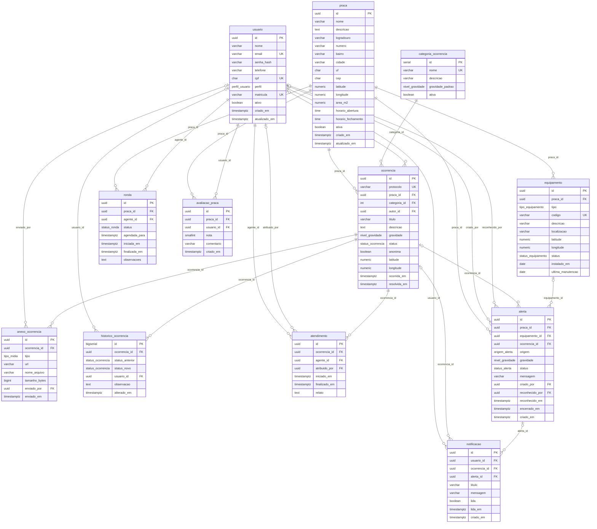

# Modelo Lógico — SafeTech

SGBD: **PostgreSQL 15+** · Schema: **`safetech`** · DDL: [`database/ddl/`](../../database/ddl/)

Convenções: tabelas no singular em `snake_case`; chave primária `id` (UUID, exceto catálogos com `SERIAL`);
chaves estrangeiras `<tabela>_id`; colunas de auditoria `criado_em` / `atualizado_em` (`TIMESTAMPTZ`).

## 1. Tipos enumerados

| Tipo | Valores |
|------|---------|
| `perfil_usuario` | CIDADAO, AGENTE, GESTOR, ADMIN |
| `status_ocorrencia` | ABERTA, EM_ANALISE, EM_ATENDIMENTO, RESOLVIDA, CANCELADA |
| `nivel_gravidade` | BAIXA, MEDIA, ALTA, CRITICA |
| `tipo_equipamento` | CAMERA, ILUMINACAO, BOTAO_PANICO, TOTEM, SENSOR_PRESENCA, SENSOR_RUIDO |
| `status_equipamento` | OPERANTE, INOPERANTE, EM_MANUTENCAO, DESATIVADO |
| `origem_alerta` | EQUIPAMENTO, BOTAO_PANICO, MANUAL |
| `status_alerta` | NOVO, RECONHECIDO, ENCERRADO, FALSO_POSITIVO |
| `tipo_midia` | IMAGEM, VIDEO, AUDIO, DOCUMENTO |
| `status_ronda` | AGENDADA, EM_ANDAMENTO, CONCLUIDA, CANCELADA |

## 2. Tabelas

Legenda: **PK** chave primária · **FK** chave estrangeira · **UK** única · **NN** not null

### usuario
| Coluna | Tipo | Restrições |
|--------|------|------------|
| id | UUID | PK, default `gen_random_uuid()` |
| nome | VARCHAR(120) | NN |
| email | VARCHAR(160) | NN, UK, formato validado |
| senha_hash | VARCHAR(255) | NN |
| telefone | VARCHAR(20) | |
| cpf | CHAR(11) | UK, apenas dígitos |
| perfil | perfil_usuario | NN, default CIDADAO |
| matricula | VARCHAR(30) | UK |
| ativo | BOOLEAN | NN, default TRUE |
| criado_em / atualizado_em | TIMESTAMPTZ | NN, default NOW() |

### praca
| Coluna | Tipo | Restrições |
|--------|------|------------|
| id | UUID | PK |
| nome | VARCHAR(150) | NN |
| descricao | TEXT | |
| logradouro | VARCHAR(150) | NN |
| numero | VARCHAR(10) | |
| bairro | VARCHAR(100) | NN |
| cidade | VARCHAR(100) | NN |
| uf | CHAR(2) | NN, `^[A-Z]{2}$` |
| cep | CHAR(8) | apenas dígitos |
| latitude | NUMERIC(9,6) | NN, −90..90 |
| longitude | NUMERIC(9,6) | NN, −180..180 |
| area_m2 | NUMERIC(10,2) | > 0 |
| horario_abertura / horario_fechamento | TIME | |
| ativa | BOOLEAN | NN, default TRUE |
| criado_em / atualizado_em | TIMESTAMPTZ | NN |

### equipamento
| Coluna | Tipo | Restrições |
|--------|------|------------|
| id | UUID | PK |
| praca_id | UUID | FK → praca (ON DELETE CASCADE), NN |
| tipo | tipo_equipamento | NN |
| codigo | VARCHAR(50) | NN, UK |
| descricao | VARCHAR(255) | |
| localizacao | VARCHAR(255) | |
| latitude / longitude | NUMERIC(9,6) | faixa validada |
| status | status_equipamento | NN, default OPERANTE |
| instalado_em / ultima_manutencao | DATE | |
| criado_em / atualizado_em | TIMESTAMPTZ | NN |

### categoria_ocorrencia
| Coluna | Tipo | Restrições |
|--------|------|------------|
| id | SERIAL | PK |
| nome | VARCHAR(80) | NN, UK |
| descricao | VARCHAR(255) | |
| gravidade_padrao | nivel_gravidade | NN, default MEDIA |
| ativa | BOOLEAN | NN, default TRUE |

### ocorrencia
| Coluna | Tipo | Restrições |
|--------|------|------------|
| id | UUID | PK |
| protocolo | VARCHAR(20) | NN, UK, gerado por trigger (`STC-AAAA-NNNNNN`) |
| praca_id | UUID | FK → praca, NN |
| categoria_id | INTEGER | FK → categoria_ocorrencia, NN |
| autor_id | UUID | FK → usuario (ON DELETE SET NULL); obrigatório se `anonima = FALSE` |
| titulo | VARCHAR(150) | NN |
| descricao | TEXT | NN |
| gravidade | nivel_gravidade | NN, default MEDIA |
| status | status_ocorrencia | NN, default ABERTA |
| anonima | BOOLEAN | NN, default FALSE |
| latitude / longitude | NUMERIC(9,6) | faixa validada |
| ocorrida_em | TIMESTAMPTZ | NN, default NOW() |
| resolvida_em | TIMESTAMPTZ | preenchido somente quando status = RESOLVIDA (trigger) |
| criado_em / atualizado_em | TIMESTAMPTZ | NN |

### anexo_ocorrencia
| Coluna | Tipo | Restrições |
|--------|------|------------|
| id | UUID | PK |
| ocorrencia_id | UUID | FK → ocorrencia (CASCADE), NN |
| tipo | tipo_midia | NN, default IMAGEM |
| url | VARCHAR(500) | NN |
| nome_arquivo | VARCHAR(255) | |
| tamanho_bytes | BIGINT | ≥ 0 |
| enviado_por | UUID | FK → usuario (SET NULL) |
| enviado_em | TIMESTAMPTZ | NN |

### historico_ocorrencia
| Coluna | Tipo | Restrições |
|--------|------|------------|
| id | BIGSERIAL | PK |
| ocorrencia_id | UUID | FK → ocorrencia (CASCADE), NN |
| status_anterior | status_ocorrencia | NULL na criação |
| status_novo | status_ocorrencia | NN |
| usuario_id | UUID | FK → usuario (SET NULL); NULL = sistema |
| observacao | TEXT | |
| alterado_em | TIMESTAMPTZ | NN |

### atendimento
| Coluna | Tipo | Restrições |
|--------|------|------------|
| id | UUID | PK |
| ocorrencia_id | UUID | FK → ocorrencia (CASCADE), NN |
| agente_id | UUID | FK → usuario, NN; perfil ≠ CIDADAO (trigger) |
| atribuido_por | UUID | FK → usuario (SET NULL) |
| iniciado_em | TIMESTAMPTZ | NN, default NOW() |
| finalizado_em | TIMESTAMPTZ | ≥ iniciado_em |
| relato | TEXT | |

### alerta
| Coluna | Tipo | Restrições |
|--------|------|------------|
| id | UUID | PK |
| praca_id | UUID | FK → praca, NN |
| equipamento_id | UUID | FK → equipamento (SET NULL); NN se origem ∈ {EQUIPAMENTO, BOTAO_PANICO} |
| ocorrencia_id | UUID | FK → ocorrencia (SET NULL) |
| origem | origem_alerta | NN |
| gravidade | nivel_gravidade | NN, default ALTA |
| status | status_alerta | NN, default NOVO |
| mensagem | VARCHAR(500) | NN |
| criado_por | UUID | FK → usuario (SET NULL); NN se origem = MANUAL |
| reconhecido_por | UUID | FK → usuario (SET NULL); par com reconhecido_em |
| reconhecido_em / encerrado_em | TIMESTAMPTZ | |
| criado_em | TIMESTAMPTZ | NN |

### ronda
| Coluna | Tipo | Restrições |
|--------|------|------------|
| id | UUID | PK |
| praca_id | UUID | FK → praca, NN |
| agente_id | UUID | FK → usuario, NN; perfil ≠ CIDADAO (trigger) |
| status | status_ronda | NN, default AGENDADA |
| agendada_para | TIMESTAMPTZ | NN |
| iniciada_em / finalizada_em | TIMESTAMPTZ | finalizada ≥ iniciada |
| observacoes | TEXT | |
| criado_em | TIMESTAMPTZ | NN |

### avaliacao_praca
| Coluna | Tipo | Restrições |
|--------|------|------------|
| id | UUID | PK |
| praca_id | UUID | FK → praca (CASCADE), NN |
| usuario_id | UUID | FK → usuario (CASCADE), NN |
| nota | SMALLINT | NN, 1..5 |
| comentario | VARCHAR(500) | |
| criado_em | TIMESTAMPTZ | NN |

### notificacao
| Coluna | Tipo | Restrições |
|--------|------|------------|
| id | UUID | PK |
| usuario_id | UUID | FK → usuario (CASCADE), NN |
| ocorrencia_id | UUID | FK → ocorrencia (CASCADE) |
| alerta_id | UUID | FK → alerta (CASCADE) |
| titulo | VARCHAR(120) | NN |
| mensagem | VARCHAR(500) | NN |
| lida | BOOLEAN | NN, default FALSE; par com lida_em |
| lida_em | TIMESTAMPTZ | |
| criado_em | TIMESTAMPTZ | NN |

## 3. Triggers e automações

| Trigger | Tabela | Efeito |
|---------|--------|--------|
| `trg_*_atualizado_em` | usuario, praca, equipamento, ocorrencia | Atualiza `atualizado_em` a cada UPDATE |
| `trg_ocorrencia_protocolo` | ocorrencia | Gera `protocolo` no INSERT (`STC-AAAA-NNNNNN`) |
| `trg_ocorrencia_resolvida_em` | ocorrencia | Preenche/limpa `resolvida_em` conforme o status |
| `trg_ocorrencia_historico` | ocorrencia | Grava em `historico_ocorrencia` na criação e a cada mudança de status |
| `trg_atendimento_validar_agente` / `trg_ronda_validar_agente` | atendimento, ronda | Impede que CIDADAO seja agente responsável |
| `trg_atendimento_atualiza_ocorrencia` | atendimento | Ao criar atendimento, ocorrência vai para EM_ATENDIMENTO |

## 4. Views

| View | Uso |
|------|-----|
| `vw_ocorrencia_aberta` | Listagem de ocorrências em aberto com praça, categoria, autor (respeitando anonimato) e quantidade de anexos |
| `vw_praca_resumo` | Indicadores por praça para o dashboard: ocorrências abertas, últimos 30 dias, alertas novos, equipamentos com problema, nota média |
| `vw_alerta_pendente` | Alertas com status NOVO, com equipamento e praça |

## 5. Diagrama ER (lógico)

